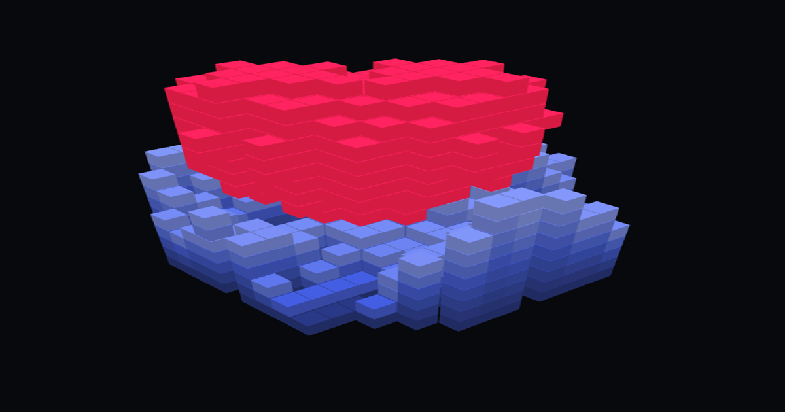

[※日本語版READMEはこちら](https://github.com/ikemfr/voxob_webapp/blob/main/README.ja.md)
# 🧊 VoxoB (Voxel Generator & Editor)

VoxoB is a lightweight, browser-based 3D voxel editor and procedural generator. 
No installation required. Run instantly in your browser.

**[🌐 Play VoxoB Live](https://VoxoB.vercel.app/)**

## ✨ Key Features
* **Zero Friction:** 100% Client-side application. No server, no login, no installation.
* **Procedural Generation:** 50 one-click generators in five groups (buildings, things, nature, shapes, patterns): houses, pagodas, torii, cities, terrain, fractals, DNA and more.
* **Next move:** one button (or N) adds the next sensible step to your model: ground, a roof, windows, trees, shading, darker edges. Every step can be undone.
* **Styles & palettes:** recolour a whole model as Japanese, retro, pastel, night, autumn or mono; palette presets including traditional Japanese colours.
* **Convert:** turn a picture, a video or typed text into a **city** (the picture read as a map: tall buildings, parks, water; from above the roofs show the picture), a **creature** (the outline puffed up), a **tower** (the outline turned like a potter's wheel), **terrain**, a **relief**, flat pixels, or, from video, a **time sculpture** (whatever moves, stacked frame by frame). The build-up can be kept as animation, and **📱 Shorts (9:16)** records source → conversion → a turn around the result as a vertical video. Everything runs in the browser.
* **Realistic 3D & 3D models:** 📐 Realistic works out depth from a single picture with classic image cues (no AI model, nothing uploaded): portraits and anime characters become figures you can walk around, landscapes become dioramas. 🧊 3D model voxelizes OBJ (+MTL, textures), STL (text or binary) and glTF / GLB, filling surfaces and insides.
* **Smooth view, sounds, Clear all:** ◐ shows the model as a smooth surface (exports follow), ⟳ turns it like a turntable; soft synthesized sound effects; 🗑 Clear all in the header, undoable.
* **Big canvases:** up to 256×256×256. The model is drawn as merged 16³ chunks with only visible faces, so a 533k-voxel scene renders in about a millisecond; big projects autosave to IndexedDB.
* **Animation Support:** Create frame-by-frame voxel animations and export them directly to WebM/MP4.
* **Broad Export Options:** Export your creations as OBJ, STL, GLB, or PNG.
* **Five languages:** English, 日本語, Español, Português and 中文 (picked from your browser language). Step-by-step guides with short demo clips: [/en/](https://voxob.vercel.app/en/) · [/ja/](https://voxob.vercel.app/ja/) · [/es/](https://voxob.vercel.app/es/) · [/pt/](https://voxob.vercel.app/pt/) · [/zh/](https://voxob.vercel.app/zh/)

## 🛠 Technology Stack
* **Graphics:** [Three.js](https://threejs.org/) (WebGL)
* **Core:** Vanilla JavaScript, HTML5, CSS3
* **Architecture:** Built entirely within a single `.html` file for extreme portability and ease of deployment.

## 🚀 How to Use
1. Visit the [Live App](https://VoxoB.vercel.app/).
2. Select a tool (Pen, Line, Fill, etc.) from the left panel.
3. Use the **Generate** panel on the right to instantly spawn complex structures.
4. Import images, videos, and 3D models and automatically convert them into voxels.
5. Export your work via the **Export** button in the header.

## 📜 License
This project is open-source and available under the MIT License.
Three.js is released under the MIT License by the three.js authors.
